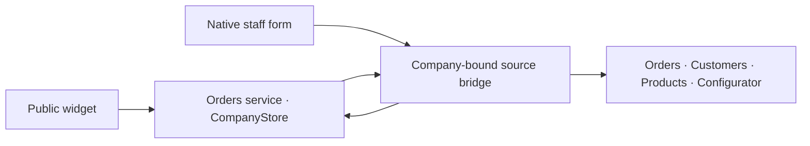
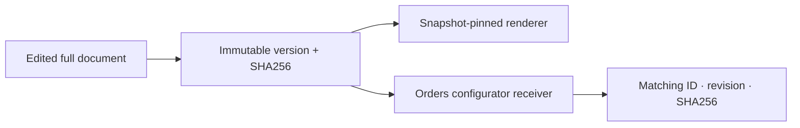

# Architecture

The project has two applications: the public Orders configurator and the manufacturer workspace. Orders owns submitted requests and catalogue-backed quoting. The workspace reads those requests, manages versioned configuration and supports the team’s review/conversation workflow.

## Request flow

| Boundary | Source | Responsibility |
| --- | --- | --- |
| Public application | [serve.py](../app/src/prototypes/orders/serve.py), [widget/](../app/src/prototypes/orders/widget/) | Serve the configurator and admit customer requests |
| Authoritative order state | [store.py](../app/src/prototypes/orders/store.py), `CompanyStore` | Orders, customer snapshots, lines, audit events and idempotent commands |
| Catalogue-backed quote | [quote.py](../app/src/prototypes/orders/quote.py), `quote` | Calculate the trusted quote from current catalogue data |
| Staff write admission | [platform_orders.py](../app/src/prototypes/orders/platform_orders.py), `create` | Validate the actor, items, quantities, fulfilment and original document |
| Company transport | [manufacturer_source_http.py](../harness/verticals/manufacturer/manufacturer_source_http.py), `RemoteCompanySource` | Bounded reads and staff writes against one commissioned Orders receiver |
| Workspace integration | [manufacturer_host.py](../harness/verticals/manufacturer/manufacturer_host.py), `ManufacturerWorkspace` | Recheck membership, present company data and expose native routes |
| Native interface | [manufacturer/web/](../harness/verticals/manufacturer/web/) | Orders, customers, products, configurator, review drawers and human conversation |

The HTTP source binding names one workspace company and one Orders slug. Requests carry the recipient’s bridge credential and exact company header; redirects are rejected. `RemoteCompanySource` reads explicit resources through `platform-state` and sends staff commands through `platform-orders`. The workspace therefore reaches the owning order service through its admitted interface rather than sharing its database file.

[platform_source.py](../app/src/prototypes/orders/platform_source.py) and [manufacturer_order.py](../harness/verticals/manufacturer/manufacturer_order.py) retain corresponding read projections. Stable display numbers derive from the first estimate event where available; the legacy fallback has its own reference namespace. Presentation keeps original order IDs and source references intact.

## State ownership

| State | Owner and rule |
| --- | --- |
| Submitted customer request | Orders `CompanyStore`; committed once for an admitted command key |
| Original attachment | Orders file store; staged first and claimed by its order |
| Configuration/catalogue versions | Workspace `ManufacturerStore`; immutable full documents with a current-version pointer |
| Publication status | Workspace `Publisher`; receipt tied to one saved version |
| Review proposals and correspondence | `ManufacturerConversations`; company/customer/order-scoped history |
| Customer review/phone capability | `CustomerPortal`; narrow, revocable access separate from workspace membership |
| Human-reported fulfilment | `ManufacturerFulfillment`; team transitions kept separate from source reservations |
| Browser staff draft | IndexedDB; draft plus the same pending command for retry |

[ManufacturerFulfillment](../harness/verticals/manufacturer/manufacturer_fulfillment.py) explicitly models human-reported progress independently of the source’s reservations. A team status change is therefore not evidence that a warehouse integration reserved or dispatched stock.

## Full snapshots and publication

[ManufacturerStore.save_document](../harness/verticals/manufacturer/manufacturer_store.py) checks the expected revision and current membership inside a SQLite write transaction. It stores the canonical full document, content hash, author and summary, then advances the company’s current pointer. Conflicting edits return a conflict for review.

`ManufacturerStore.restore` reads the selected version’s exact stored canonical content and saves it as a new revision. Catalogue and configuration travel together. Restore therefore includes the old questions, product definitions and commercial values rather than reconstructing them from current defaults.

[manufacturer_preview.renderer and html](../harness/verticals/manufacturer/manufacturer_preview.py) verify renderer bytes by SHA256, require the complete public picker bundle and pin its renderer manifest to the full snapshot hash. The preview injects the saved document into that renderer. Source checks and membership checks remain part of serving a saved preview.

[Publisher.publish](../harness/verticals/manufacturer/manufacturer_publish.py) serializes publication and sends the saved version to the commissioned receiver. It accepts publication only when the receipt confirms `ok`, `published`, version ID, revision and content hash. A saved version remains pending when that matching receipt is unavailable. The Orders-side [configurator_versions.Bridge](../app/src/prototypes/orders/configurator_versions.py) validates the incoming document and records its applied version.

## Staff command and attachment flow

[manufacturer-new-order.js](../harness/verticals/manufacturer/web/manufacturer-new-order.js) freezes the pending customer/items/file command with an idempotency key and saves it in IndexedDB. [manufacturer_manual_orders.create](../harness/verticals/manufacturer/manufacturer_manual_orders.py) derives attribution from the authenticated member; the browser supplies the order fields, while the server supplies the actor.

The Orders receiver checks `CompanyStore.replay` before current catalogue checks and file staging. `CompanyStore._write` binds the command digest to its key in the same transaction as the resulting order/audit records. An unchanged retry returns the committed result; changed input with the same key is rejected.

The staff path accepts 1–100 distinct catalogue items, integer quantities of 1–9999 and an optional original document up to 4 MB. [order_files.stage](../app/src/prototypes/orders/order_files.py) validates file bytes before an order claims the file. Workspace file access rechecks exact company/order/file ownership; PDF page rendering is a separate bounded operation.

Specification parsing preserves the source file and cell references. [spec_workbook.parse](../app/src/prototypes/orders/spec_workbook.py) records receiving destinations and per-line allocations, including a confirmation requirement. [spec_receipts.py](../app/src/prototypes/orders/spec_receipts.py) retains the extraction receipt. Customer receiving allocations and the supplier’s selected dispatch warehouse remain separate fields throughout presentation.

## Access and capabilities

Membership gates belong to [ManufacturerWorkspace.member](../harness/verticals/manufacturer/manufacturer_host.py) and the host middleware. Company reads, operator writes and owner settings/team actions have distinct checks. Public customer links use [CustomerPortal](../harness/verticals/manufacturer/manufacturer_customer_portal.py), with their own scope and lifecycle.

The `agent_editing` and `customer_research` flags are company capabilities. The source release can run the manual workflow with both disabled. The shared UI’s `canLoadAgentResources` reads authoritative company capability metadata and skips hidden agent chats, agents and connection loaders for manual manufacturer sessions. The server keeps its existing admission gate; the UI gate avoids unnecessary denied requests. Other installed SDK verticals retain their original resource-loading behaviour.

English display prefers `en` and falls back to `bg`. English questionnaire writes merge the localized field, preserving its other language. Technical field names, status values and API IDs stay stable across that presentation change.

## Optional services

| Service | Integration source | Commissioning boundary |
| --- | --- | --- |
| Agent editing and research | [manufacturer_tools.py](../harness/verticals/manufacturer/manufacturer_tools.py), [research_queue.py](../harness/verticals/manufacturer/research_queue.py), [harness/server.py](../harness/server.py) | Recipient-owned agent runtime, grants and enabled company capabilities |
| Customer email | [manufacturer_mail_routes.py](../harness/verticals/manufacturer/manufacturer_mail_routes.py), [manufacturer_conversations.py](../harness/verticals/manufacturer/manufacturer_conversations.py) | Recipient-owned sender and delivery transport; drafts/reviews have their own saved state |
| Chatwoot | [manufacturer_chatwoot.py](../harness/verticals/manufacturer/manufacturer_chatwoot.py), [manufacturer_chatwoot_routes.py](../harness/verticals/manufacturer/manufacturer_chatwoot_routes.py) | Recipient-owned account, inbox and webhook configuration |

The native first result exercises the recipient-owned public widget, Orders authority, bridge and workspace using authored sample data. It establishes that local workflow; paid model execution, outbound mail and external helpdesk delivery need their own commissioning and verification. The [README](../README.md) owns startup and credentials; [product decisions](UX.md) explains the interface.

[made by atelier neyra](https://atelierneyra.com)
