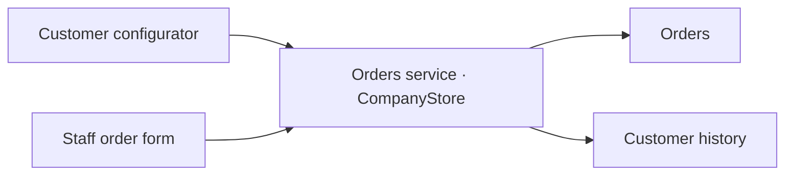
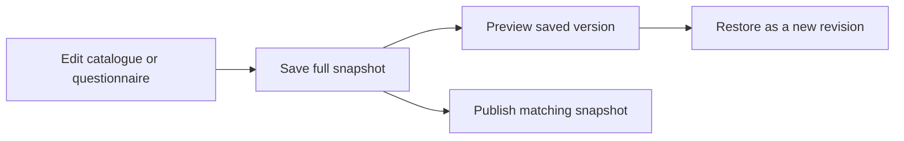

# Product decisions

This guide connects the retained interface to the engineering rules behind it. Sample Hardware supplies authored sample data; the order desk and configurator use the actual product components and stores.

## Order entry

Customers can select catalogue items, answer a questionnaire or attach a specification. Staff can enter an order in the workspace. These entry points feed the same authoritative order service, so a team can follow one request through Products, Orders and the customer’s history.

The staff form asks for company, contact, items and fulfilment together. Product choice and quantity remain editable before submission. [manufacturer-new-order.js](../harness/verticals/manufacturer/web/manufacturer-new-order.js) implements the form; [platform_orders.create](../app/src/prototypes/orders/platform_orders.py) validates it against the current catalogue. Creating a request, sending it and accepting it are separate actions. Staff entry therefore preserves the point at which a human made a commercial commitment.

## Saved drafts and retries

The staff form saves its draft and pending command in IndexedDB. Once submission begins, the same command and idempotency key remain available for retry. A connection failure can leave the browser uncertain even when the server committed the order; retrying that command resolves the uncertainty without duplicating the request.

[CompanyStore._write and replay](../app/src/prototypes/orders/store.py) compare the command digest with its key. Reusing a key for different input is rejected. [platform_orders.create](../app/src/prototypes/orders/platform_orders.py) resolves an already committed command before current catalogue validation or file staging, so a later catalogue edit cannot turn a successful retry into a second interpretation of the order.

## Prices and quotations

The interface separates priced items, items awaiting a quote and the priced subtotal. An unknown price remains an unknown commercial value. A real numeric zero remains a valid price.

The Products editor represents “on request” with the catalogue’s quotation flag; entering zero keeps a numeric zero with that flag cleared. [manufacturer-products.js](../harness/verticals/manufacturer/web/manufacturer-products.js) saves this distinction. [project_order](../harness/verticals/manufacturer/manufacturer_order.py) preserves `null` totals for incomplete quotations and exposes `priced_total` separately. This keeps a partial subtotal from appearing as a complete order total.

Prices are shared catalogue data. A price edit creates the same versioned document used by the public configurator, which gives the team one place to review the commercial change.

## Specifications and receiving locations

An uploaded specification remains attached to its order. The team can inspect the original, download it or view a PDF page beside the interpreted request. The source document gives a reviewer a way to resolve an ambiguous item or quantity.

Spreadsheet allocation matrices preserve customer receiving locations, quantities and source-cell references. The supplier’s dispatch warehouse is a separate fulfilment choice. [spec_workbook.parse](../app/src/prototypes/orders/spec_workbook.py) records the allocation evidence; [manufacturer-tabs.js](../harness/verticals/manufacturer/web/manufacturer-tabs.js) presents it separately from the dispatch warehouse. The team can therefore distinguish where goods should arrive from where it will send them.

[order_files.py](../app/src/prototypes/orders/order_files.py) stages and claims attachments for an order. [manufacturer_order_files.py](../harness/verticals/manufacturer/manufacturer_order_files.py) checks company membership and exact order/file ownership when the workspace opens an original or renders a PDF page.

## Configuration history

A version contains the full configuration and catalogue: questions, choices, labels, product data and prices. History shows the author, time and summary. The preview opens that saved document with a pinned renderer, so a reviewer can inspect the version they actually selected.

Restore reuses the selected version’s exact canonical document and creates a new revision. It preserves the intervening history. [ManufacturerStore.save_document and restore](../harness/verticals/manufacturer/manufacturer_store.py) implement that rule; [manufacturer_preview.py](../harness/verticals/manufacturer/manufacturer_preview.py) verifies and pins the complete public widget renderer.

Saving and publication have separate visible states. [Publisher.publish](../harness/verticals/manufacturer/manufacturer_publish.py) marks a version published only after the receiver returns its matching version ID, revision and SHA256. The user can distinguish a saved change from the version currently applied to the website.

## Customer review and conversation

The review drawer collects item quantities, prices, delivery and the customer note in one proposal. A customer link identifies a particular proposal version. The customer can confirm that version or request a change, keeping the discussion attached to the commercial terms being reviewed.

[manufacturer-order-review.js](../harness/verticals/manufacturer/web/manufacturer-order-review.js), [ManufacturerConversations](../harness/verticals/manufacturer/manufacturer_conversations.py) and [CustomerPortal](../harness/verticals/manufacturer/manufacturer_customer_portal.py) provide the review flow. Customer capabilities are separate from workspace sign-in. Email delivery is commissioned separately; a prepared review and its recorded state remain useful before a sender is connected.

The workspace’s team conversation is human service. Agent editing is a distinct optional capability. This preserves the manual order workflow when the recipient enables catalogue and order operations first.

## Languages and access

The release reads English first and preserves other saved languages. Questionnaire edits write `en` while retaining `bg`; new English copy therefore leaves the historical translation available. The source keeps technical keys, statuses and route IDs stable.

Owners manage company settings, versions and team access. Operators can enter orders; browse members read their permitted company views. Agent-only resources additionally require the manufacturer’s `agent_editing` capability. The shared UI checks that capability before loading those resources, while server authorization remains authoritative. See [manufacturer_host.py](../harness/verticals/manufacturer/manufacturer_host.py), [manufacturer-tabs.js](../harness/verticals/manufacturer/web/manufacturer-tabs.js) and [harness/web/app.js](../harness/web/app.js).

## First result and extensions

The first result uses the native public configurator, recipient-owned Orders service and native manufacturer workspace with authored sample data. Agent research/editing, outbound email and Chatwoot are separate integrations with their own credentials, permissions and verification. The [setup guide](../README.md) owns those entry points; [architecture](ARCHITECTURE.md) maps the code boundaries.

[made by atelier neyra](https://atelierneyra.com)
